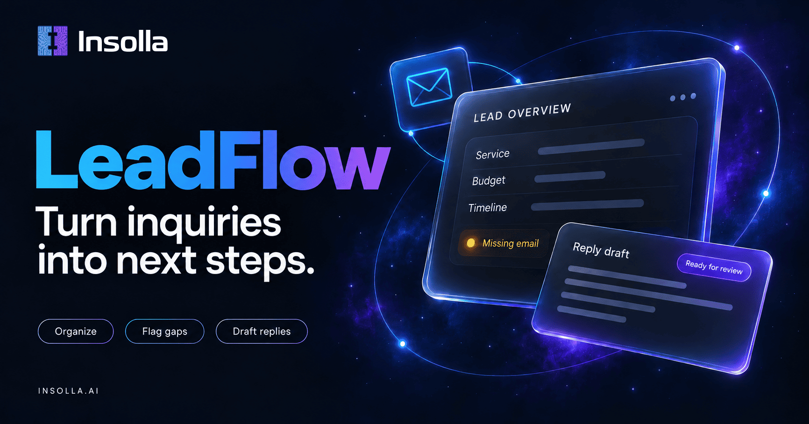

# LeadFlow

One inquiry. Organized facts. Extract first, then one reply draft.

## Demo

The short walkthrough and the write-up will be linked here once the demo is live. The opening beat is an agency inquiry from Taylor at Fieldwork: a website redesign before a January launch, budget around $8,000, and no email address. LeadFlow shows those facts, flags the missing email, and drafts a reply that asks for an address without promising the work.

## The customer problem

A business pastes a customer email into an AI and sends the reply it writes. The model fills in a price, a time, or an email address the customer never gave. The answer sounds ready, and nothing records what was missing or whether a person checked it.

LeadFlow is an Insolla portfolio prototype of the intake step:

Inquiry → Organize → Flag gaps → Draft → Track

The program organizes one message, flags what is still missing, and writes a draft a person reviews. It does not send the email, book a calendar, update a CRM, or speak for the business.

## What it does

- Accepts an inquiry for one of three fictional businesses: home services, agencies, or real estate
- Extracts typed facts from the message with one structured model call
- Drops contact and detail fields that do not appear in the message
- Lists required fields that are still missing and suggests a destination
- Writes a reply draft from those organized facts, instructed not to invent a price, a time, or a commitment
- Saves the inquiry, the result, and a needs-review status in a private tracker

## Stack

| Layer | Choice | Why |
| --- | --- | --- |
| Language | TypeScript | Types the inquiry, the extracted facts, and the result |
| App | Next.js | Serves the page and the API from one project |
| Contracts | Zod | Validates the request and defines the extraction fields |
| Model | OpenAI | Extracts typed facts, then writes the reply draft |
| Database | Supabase Postgres | Stores each submission for a person to review |
| Verification | Cloudflare Turnstile | Checks the visitor before a paid model call |
| Hosting | Vercel | Deploys the app and keeps the server secrets off the page |
